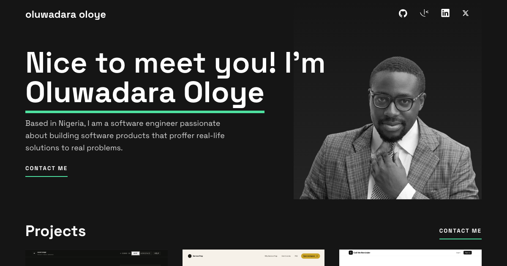

# Oluwadara Oloye: Portfolio

My personal site. It lists my projects with links to the live app, code, and demo videos, and has a contact form.

Live site: https://oluwadara-oloye.netlify.app/



## Stack

- [Vue 3](https://vuejs.org/) and [Vite](https://vite.dev/)
- SCSS
- [Vuelidate](https://vuelidate-next.netlify.app/) for form validation
- Netlify for hosting and form submissions

## Run it locally

Use the Node version in `.nvmrc`, then:

```sh
npm ci
npm run dev     # dev server
npm run build   # production build in dist/
```

The projects on the home page live in `src/data/constants.js`.

## Elsewhere

- GitHub: [@OluwadaraDaily](https://github.com/OluwadaraDaily)
- LinkedIn: [oluwadara-oloye](https://www.linkedin.com/in/oluwadara-oloye)
- X: [@OluwadaraDaily](https://x.com/OluwadaraDaily)
